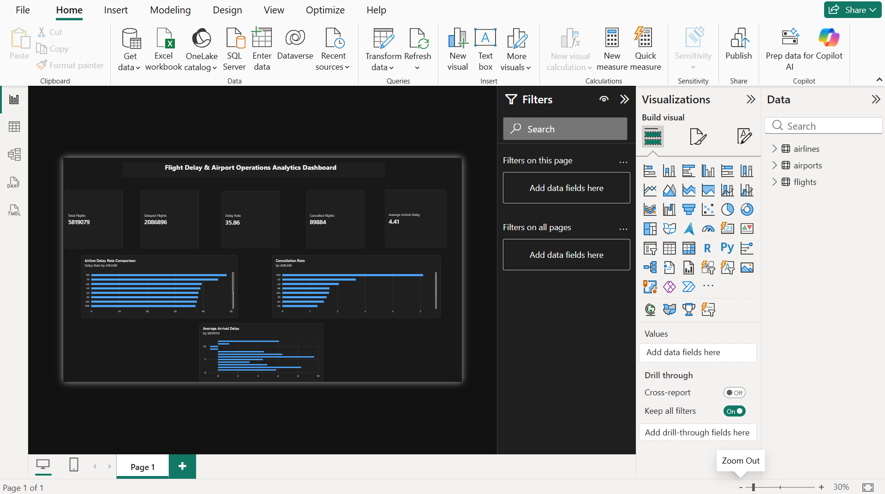

# Flight Delay & Airport Operations Analytics

A data analytics project exploring flight delays, cancellations, airline performance, airport patterns, and seasonal trends in the 2015 U.S. flight dataset.

## Dashboard



The Power BI dashboard contains five KPI cards and three visuals:
- Airline delay-rate comparison
- Cancellation rate by airline
- Average arrival delay by month

Open [Flight Delay Analytics Dashboard.pbix](Flight%20Delay%20Analytics%20Dashboard.pbix) in Power BI Desktop to explore the report.

## Key findings

Based on the analysis of the dataset:

| Metric | Result |
|---|---:|
| Flights in dataset | 5,819,079 |
| Flights with positive arrival delay | 2,086,896 |
| Overall delay rate reported by the project | 35.86% |
| Cancelled flights | 89,884 |
| Cancellation rate | 1.54% |
| Average arrival delay | 4.41 minutes |

The analysis also compares airline delay rates, monthly average arrival delays, cancellation rates, destination-airport delay rates, and reported causes of delay. In the cause breakdown, late-arriving aircraft and airline-related issues are the largest categories.

**Metric note:** Arrival-delay analyses exclude rows where `ARRIVAL_DELAY` is missing. The overall KPI definitions should be checked against the Power BI measures before comparing numbers across tools.

## Tools

- Python
- Pandas
- Matplotlib and Seaborn
- SQL and SQLite
- Power BI and DAX

## Repository structure

```text
flight-delay-analytics/
├── data/                         # Downloaded CSV files (not committed)
│   ├── flights.csv
│   ├── airlines.csv
│   └── airports.csv
├── sql/
│   └── flight_delay.db           # Generated locally; not committed
├── flight_delay_analysis.py
├── load_database.py
├── run_sql.py
├── flight_delay_analysis.sql
├── dashboard.png
├── Flight Delay Analytics Dashboard.pbix
├── requirements.txt
└── README.md
```

## Setup

### 1. Install Python dependencies

Install Python 3.10 or newer, then run this from the repository folder:

```bash
python -m pip install -r requirements.txt
```

On Windows, if `python` is not recognized, use `py` instead.

### 2. Download the dataset

Download the **2015 Flight Delays and Cancellations** dataset from [Kaggle — US DOT Flight Delays](https://www.kaggle.com/datasets/usdot/flight-delays). Extract the files and place `flights.csv` and `airports.csv` inside a folder named `data` in the repository root. Keep `airlines.csv` there as well if you want the original lookup file available.

The raw dataset is not included in this repository because it is large. You may need a Kaggle account to download it.

### 3. Run the Python analysis

From the repository root:

```bash
python flight_delay_analysis.py
```

The script reads `data/flights.csv` and `data/airports.csv`, prints analysis results, and displays charts.

### 4. Build the SQLite database

Run this once after placing `data/flights.csv`:

```bash
python load_database.py
```

This creates `sql/flight_delay.db` and loads the flights table. The script removes an existing generated database first, so rerunning it rebuilds the database instead of duplicating rows.

### 5. Run the SQL KPI summary

```bash
python run_sql.py
```

This prints the overall KPI summary from the SQLite database created in the previous step. Additional reusable queries are available in `flight_delay_analysis.sql`.

## Important definitions

- **Positive arrival delay:** `ARRIVAL_DELAY > 0`.
- **Delay rate:** delayed flights divided by the chosen flight denominator. Verify whether cancelled flights and rows with missing arrival delay are excluded when comparing across tools.
- **Average arrival delay:** mean of available `ARRIVAL_DELAY` values, in minutes.
- **Cancellation rate:** cancelled flights divided by the chosen flight denominator.

## Dataset source

U.S. Department of Transportation flight delays and cancellations (2015), distributed through Kaggle:  
https://www.kaggle.com/datasets/usdot/flight-delays

## Author

Esha Patel
